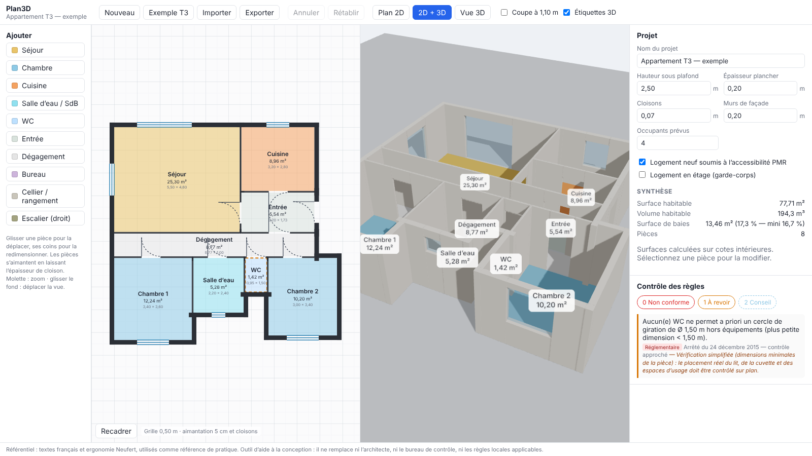
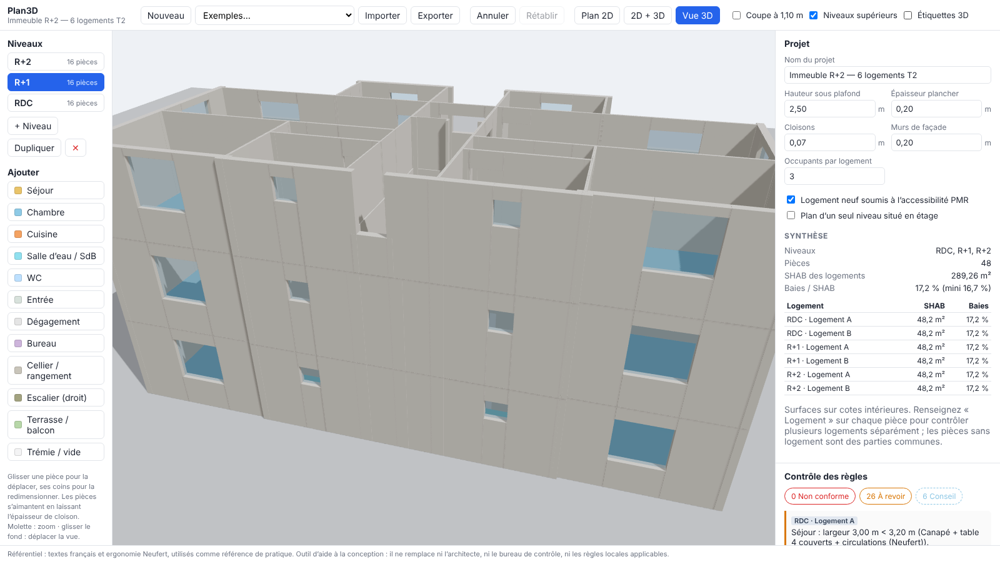

# Plan3D — modélisation de plans de logement en 2D/3D avec contrôle des règles





Application web pour dessiner un plan de logement en 2D, le voir en 3D et le contrôler en continu. Chaque contrôle cite sa source : textes français et ergonomie Neufert.

## Démarrer

```bash
cd plan3d
npm install
npm run dev        # http://localhost:5173
npm test           # tests du moteur de règles
npm run build      # typecheck + build de production dans dist/
```

## Fonctions (v0.1)

- **Éditeur 2D** : pièces rectangulaires en cotes intérieures. Glisser pour déplacer, tirer les coins pour redimensionner. Aimantation à 5 cm et à l'épaisseur de cloison pour accoler deux pièces. Zoom à la molette, déplacement de la vue en glissant le fond. Murs, portes avec débattement, fenêtres, escalier.
- **Niveaux et logements** : onglets RDC, R+1…, ajout, duplication et suppression d'un niveau. Le niveau inférieur s'affiche en filigrane. Chaque pièce peut être rattachée à un logement ; les règles sont alors contrôlées par logement, et les pièces sans logement forment les parties communes. Types « Escalier », « Trémie / vide », « Terrasse / balcon » et ouverture « Baie libre ».
- **Vue 3D** (Three.js) : niveaux empilés avec dalles ; affichage jusqu'au niveau actif ou de tout le bâtiment ; murs découpés aux baies (allèges, linteaux), vitrages, marches d'escalier, étiquettes. Option de coupe à 1,10 m.
- **Inspecteur** : saisie des cotes au clavier (virgule acceptée), ouvertures (type, mur, décalage, largeur, hauteur, allège, porte d'entrée), paramètres du projet (HSP, plancher, cloisons, façade, occupants, PMR, étage).
- **Contrôle des règles** en temps réel, classé par gravité, avec la source et ses réserves. Cliquer sur un défaut sélectionne la pièce.
- **Plans PDF** : dossier A3 paysage, une planche par niveau, à l'échelle normalisée la plus grande qui tient (1/50, sinon 1/100 ou 1/200), identique sur toutes les planches pour qu'elles se superposent. Chaque planche comporte les murs coupés en poché, les portes avec débattement, les fenêtres, l'escalier avec sa ligne de foulée, les trémies, la désignation et la surface de chaque pièce, des chaînes de cotes partielles et totales, une échelle graphique, le tableau des surfaces par logement et un cartouche (projet, niveau, échelle, date, indice, mentions de réserve). Exemple : [`docs/immeuble-r2-plans.pdf`](docs/immeuble-r2-plans.pdf).
- Annuler/rétablir (Ctrl+Z / Ctrl+Maj+Z), déplacement aux flèches (Maj = 50 cm), Suppr, sauvegarde locale automatique, import/export JSON.

Le référentiel complet (seuils, sources, points à vérifier) est dans [`docs/REGLES.md`](docs/REGLES.md).

## Architecture

```
src/
  model/      types, géométrie (voisinage, portes, façades), murs, historique, exemple T3
  rules/      catalogue des types de pièces + sources, moteur de règles (pur, testé)
  editor/     éditeur 2D SVG
  viewer/     vue 3D (@react-three/fiber)
  ui/         inspecteur, panneau des défauts, champs
```

Le moteur de règles (`src/rules/engine.ts`) est indépendant de l'interface. Ajouter une règle revient à écrire une fonction `(plan, push) => void` et à citer une entrée de `SOURCES`.

## Limites connues

Pièces rectangulaires uniquement, même hauteur sous plafond à tous les niveaux. Les contrôles PMR sont approchés, car le mobilier n'est pas modélisé. Le référentiel est français : son application au Gabon relève de la pratique, pas d'une obligation légale. Voir la feuille de route dans `docs/REGLES.md`.
